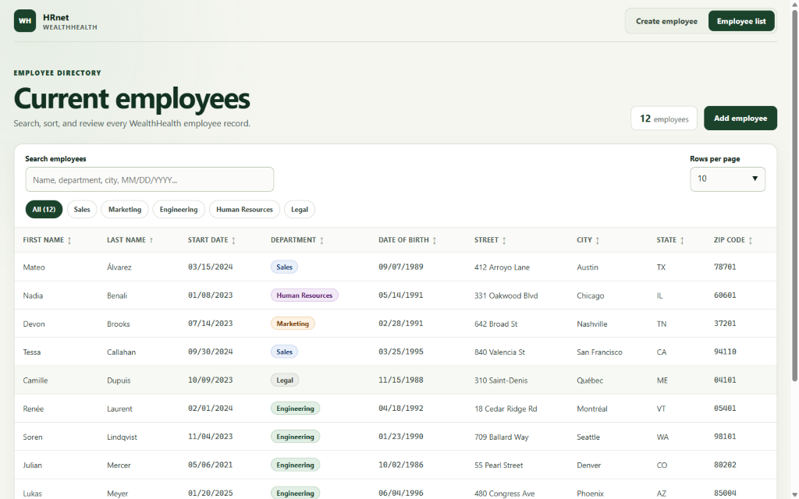

# HRnet React

HRnet React is the OpenClassrooms migration of WealthHealth's employee form
and directory from jQuery to React. Create a record, confirm it in the modal,
then search, sort, or page through the directory. Records are stored locally in
the browser.



[Nyx People](https://github.com/DRGYZ/nyx-people) is a separate follow-on project.

## Project goals

- Replace both legacy HRnet pages with React routes.
- Remove all runtime jQuery code and jQuery plugins.
- Manage employee records with React Context and a reducer.
- Keep browser persistence behind a dedicated local-storage adapter.
- Consume the independently packaged React modal converted from `jquery-modal`.
- Replace DateTimePicker and Selectmenu with accessible native React controls.
- Replace DataTables with a focused React table implementation.
- Compare production performance with the untouched legacy application.

## Features

- Create employees with validated personal, employment, and address fields.
- Persist records between browser sessions and report when a record could only
  be saved for the current visit.
- Confirm creation through the accessible `@drgyz/hrnet-accessible-modal`
  package.
- Search all employee fields, including displayed dates and names with accents.
- Sort every table column.
- Select a page size and move through paginated results.
- Responsive layouts and keyboard-visible focus states.

## Run locally

Use Node.js 24, npm, and Git.

```bash
npm ci
npm run dev
```

Open the URL shown by Vite. The employee form is at `/` and the directory at
`/employees`. When serving the build, configure the host to serve `index.html`
for direct requests to `/employees`.

The application pins the converted library's public
[`v0.2.1`](https://github.com/DRGYZ/react-hrnet-modal/tree/v0.2.1) source tag.
The same release is published as
[`@drgyz/hrnet-accessible-modal`](https://github.com/DRGYZ/react-hrnet-modal/pkgs/npm/hrnet-accessible-modal)
on GitHub Packages. The source tag keeps a fresh clone installable without a
registry token, because GitHub requires authentication to install npm-format
packages even when their package page is public. The npm lockfile resolves
the release commit over HTTPS.

## Quality commands

```bash
npm run check
```

The check runs ESLint, Vitest, and the production build locally and in GitHub
Actions. For a Lighthouse comparison, run `npm run preview` after building and
use the same Lighthouse version and settings for both implementations.

## Architecture

- `src/pages`: route-level Create Employee and Employee List pages.
- `src/components`: reusable form, layout, and table components.
- `src/state`: reducer, context, and persistence integration.
- `src/data`: stable state and department option data.
- `src/utils`: presentation helpers such as date formatting.

See [docs/ARCHITECTURE.md](docs/ARCHITECTURE.md) for the reasoning behind the
main decisions.
